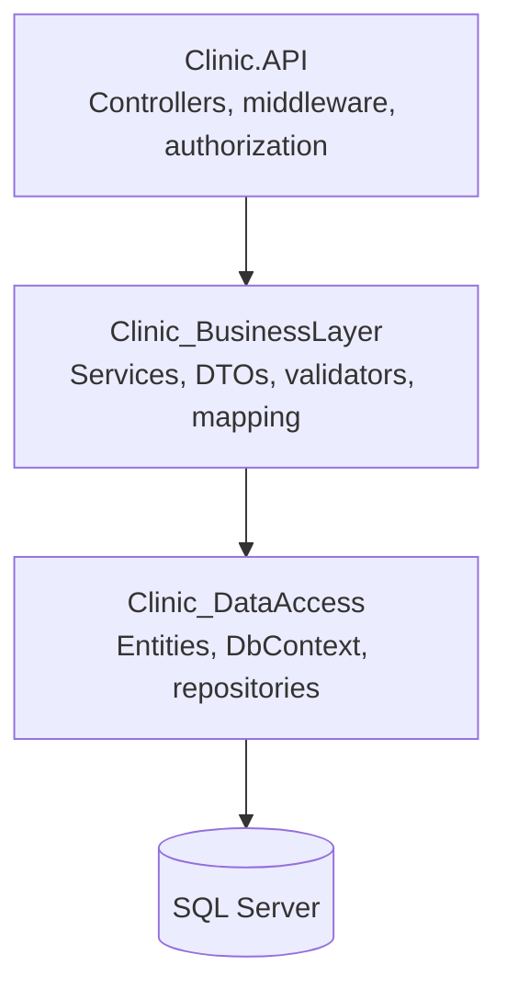
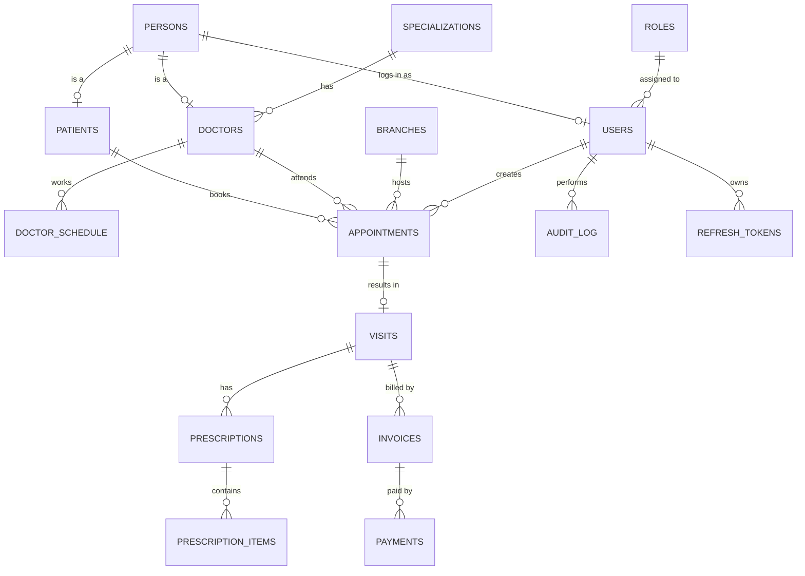

# Clinic Management API

A RESTful back-end for running a small-to-medium clinic: patients, doctors, appointments, visits, prescriptions, billing, and an audit trail. Built with ASP.NET Core and SQL Server using a 3-tier architecture.


## Table of Contents

- [Features](#features)
- [Tech Stack](#tech-stack)
- [Architecture](#architecture)
- [Database](#database)
- [Getting Started](#getting-started)
- [API Overview](#api-overview)
- [Security](#security)
- [Business Rules](#business-rules)
- [Project Structure](#project-structure)
- [License](#license)
- [Author](#author)

## Features

- **Patients and doctors**: personal data is stored once in `Persons`; a person can be a patient, a doctor, and a system user without duplicating data.
- **Appointments**: 15-minute slots, per-doctor schedules, branch support, status lifecycle (`Scheduled`, `Confirmed`, `CheckedIn`, `Completed`, `Cancelled`, `NoShow`).
- **Medical records**: visits with symptoms, diagnosis, and vital signs; prescriptions with multiple medication items.
- **Billing**: invoices per visit and payments per invoice.
- **Authentication and authorization**: JWT access tokens, refresh-token rotation, role-based access (Admin, Doctor, Receptionist), and ownership rules (a doctor sees only their own appointments).
- **Audit log**: field-level change tracking (who changed what, old and new value).
- **Database-managed timestamps**: `CreatedAt` and `UpdatedAt` are filled automatically (defaults and triggers), and `DELETE` on soft-deletable tables sets `DeletedAt` instead of removing the row.
- **Operational basics**: global exception handling, structured logging, rate limiting, and interactive API docs.

## Tech Stack

| Area | Technology |
|---|---|
| Framework | .NET 10, ASP.NET Core Web API |
| ORM | Entity Framework Core 10 |
| Database | SQL Server 2022+ |
| Mapping / Validation | AutoMapper, FluentValidation |
| Security | JWT Bearer, BCrypt.Net-Next |
| Logging | Serilog |
| API docs | Scalar |

## Architecture

Three projects, each depending only on the one below it:



| Layer | Responsibility |
|---|---|
| **API** | HTTP concerns: routing, request validation, authentication, authorization policies, error responses. |
| **Business** | Business rules (slot rules, existence checks, ownership), DTO mapping, token and password helpers. |
| **Data access** | EF Core entities, `DbContext`, repositories, unit of work. |

## Database

The schema is created by plain SQL migration files in [`Migrations/`](Migrations), applied in order (`V001` to `V010`). Applied files are never edited; changes go into a new file.



| Migration | Purpose |
|---|---|
| `V001` | Create the `ClinicDB` database |
| `V002` | Lookup tables: Roles, Specializations, Branches |
| `V003` | Persons, Patients, Doctors, Users, DoctorSchedule |
| `V004` | Appointments |
| `V005` | Visits, Prescriptions, PrescriptionItems |
| `V006` | Invoices, Payments, AuditLog |
| `V007` | Indexes (filtered unique indexes for soft-deletable tables) |
| `V008` | Triggers: automatic `UpdatedAt` and soft delete |
| `V009` | Seed data: roles and specializations |
| `V010` | RefreshTokens |

Conventions: all timestamps are UTC (`DATETIME2`), text columns are `VARCHAR` (English-only data), and every foreign key has a supporting index.

## Getting Started

### Prerequisites

- [.NET 10 SDK](https://dotnet.microsoft.com/download)
- SQL Server 2022+ (Express is enough) and the `sqlcmd` tool
- Visual Studio 2026, VS Code, or Rider
- Git

### 1. Clone

```bash
git clone https://github.com/mocode218-creator/clinic-api.git
cd clinic-api
```

### 2. Create the database

Run the migrations in order (PowerShell). `-b` stops at the first error:

```powershell
Get-ChildItem .\Migrations\V*.sql | Sort-Object Name | ForEach-Object {
    Write-Host "Running $($_.Name)"
    sqlcmd -S "localhost\SQLEXPRESS" -E -I -b -i $_.FullName
}
```

Or open each file in SSMS and execute it, in order.

Verify:

```sql
USE ClinicDB;
SELECT name FROM sys.tables ORDER BY name;   -- 16 tables
SELECT * FROM Roles;                          -- Admin, Doctor, Receptionist, Nurse, Patient
```

### 3. Configure


```

Keep the signing key **out of source control**. Use user secrets in development and an environment variable in production:

```bash
cd Clinic.API
dotnet user-secrets set "Jwt:Key" "<random string, at least 64 characters>"
```

### 4. First admin account

`POST /api/v1/Auth/Register` requires an Admin, so the very first admin must be created directly in the database (a `Persons` row, then a `Users` row with a BCrypt password hash and the `Admin` role).

### 5. Run

```bash
cd Clinic.API
dotnet run
```

API docs are served by Scalar at `https://localhost:7047/scalar/v1` (the port may differ on your machine, see the console output).

## API Overview

All routes are under `/api/v1`. `Auth` column: who may call the endpoint.

### Authentication

| Method | Endpoint | Description | Auth |
|---|---|---|---|
| POST | `/Auth/Login` | Log in, receive access and refresh tokens | Public |
| POST | `/Auth/Register` | Create a user | Admin |
| POST | `/Auth/RefreshToken` | Exchange a refresh token for a new access token | Public |
| POST | `/Auth/Logout` | Revoke the refresh token | Authenticated |

### Appointments

| Method | Endpoint | Description | Auth |
|---|---|---|---|
| GET | `/Appointments/All` | List appointments | Authenticated |
| GET | `/Appointments/{id}` | Get one appointment | Authenticated |
| GET | `/Appointments/ByPatient/{id}` | Appointments of a patient | Authenticated |
| GET | `/Appointments/ByDoctor/{id}/ByDate` | A doctor's appointments on a date | Authenticated |
| POST | `/Appointments` | Book an appointment | Admin, Receptionist |
| PUT | `/Appointments/{id}` | Update | Authenticated |
| PATCH | `/Appointments/{id}/Cancel` | Cancel (sets status `Cancelled`) | Authenticated |
| DELETE | `/Appointments/{id}` | Delete | Admin |

### Patients and Doctors

| Method | Endpoint | Description |
|---|---|---|
| GET | `/Patients/All`, `/Patients/{id}`, `/Patients/Search?term=` | List, get, search patients |
| POST / PUT / DELETE | `/Patients`, `/Patients/{id}` | Create, update, soft-delete a patient |
| GET | `/Doctors/All`, `/Doctors/{id}`, `/Doctors/BySpecialization/{id}` | List, get, filter doctors |
| POST / PUT / DELETE | `/Doctors`, `/Doctors/{id}` | Create, update, soft-delete a doctor |

### Other resources

Roles, Users, Branches, Specializations, DoctorSchedules, Visits, Prescriptions, Invoices, Payments, and AuditLogs follow the same REST conventions. Roles, Users, and AuditLogs are Admin-only.

## Security

- **Tokens**: short-lived JWT access token plus a refresh token stored server-side (`RefreshTokens` table) with expiry, revocation, and rotation (`ReplacedByToken`).
- **Passwords**: hashed with BCrypt, never stored in plain text.
- **Roles**: Admin (everything), Doctor (own appointments, visits, prescriptions), Receptionist (patients, appointments, invoices).
- **Ownership policies**: a doctor can only access their own appointments; a user can only edit their own profile.
- **Rate limiting**:

| Policy | Limit | Window |
|---|---|---|
| Per user | 100 requests | 1 minute |
| Per IP | 30 requests | 1 minute |
| Login | 5 requests | 1 minute |
| Register | 3 requests | 5 minutes |
| Refresh token | 10 requests | 1 minute |

- **Transport**: HTTPS and a configured CORS policy.

## Business Rules

- The client sends `patientId`, `doctorId`, `branchId`, `startDate`, `type`, and an optional `note`. The server sets the id, `createdBy` (from the token), the initial status (`Scheduled`), and `endDate` (start + 15 minutes).
- Appointments start on a 15-minute slot, cannot be in the past, and cannot be booked more than 60 days ahead.
- The same doctor cannot have two active appointments at the same time (`409 Conflict`).
- Appointment types: `Consultation`, `FollowUp`, `Emergency`, `Procedure`.
- Appointments, visits, invoices, payments, and prescriptions are never soft-deleted: they are historical, medical, or financial records. A cancelled appointment keeps its row with status `Cancelled`.

## Project Structure

```text
Clinic API Project/
├── Migrations/                 SQL migration files (V001 - V010)
├── Clinic_DataAccess/
│   ├── Context/                DbContext
│   ├── Entities/               One class per table
│   ├── Repositories/           Interfaces, implementations, UnitOfWork
│   └── Extensions/             DI registration
├── Clinic_BusinessLayer/
│   ├── DTOs/                   Requests and responses
│   ├── Validators/             FluentValidation rules
│   ├── Mapping/                AutoMapper profiles
│   ├── Helpers/                JWT and password helpers
│   ├── Exceptions/             Custom exceptions
│   └── Services/               Interfaces and implementations
├── Clinic.API/
│   ├── Controllers/
│   ├── Middleware/             Global exception handling
│   ├── Authorization/          Requirements and handlers
│   ├── Services/               Current-user service
│   └── Program.cs
└── README.md
```


## License

Released under the MIT License. See [LICENSE](LICENSE).

## Author

- GitHub: https://github.com/mocode218-creator
- LinkedIn: https://www.linkedin.com/in/moamen-mohamed-0bb938328
- Gmail: mocode218@gmail.com
